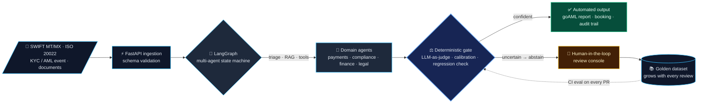

<!-- ═══════════════════════════════════════════════════════════════════════
     Manoj Kumar P · GitHub profile README
     ═══════════════════════════════════════════════════════════════════════ -->

 

&nbsp;
&nbsp;

  

 

## 🧭 About me

<table>
<tr>
<td width="50%" valign="top">

### What I build
- **Agents that are governed, not just clever** — LangGraph state machines that *stop* for a human when unsure, hash-chained audit trails, four-eyes approvals.
- **Evaluation as infrastructure** — golden datasets, LLM-as-judge, measured noise floors, release gates in CI that refuse to ship a model that got worse.
- **Models that know when to abstain** — calibrated confidence and selective prediction for vision and language models, with the trade-off measured, not assumed.
- **RAG and document intelligence over regulated, messy data** — payment messages, compliance alerts, invoices, German tax notices.

</td>
<td width="50%" valign="top">

### Where I come from
- **14+ years inside global banks** — Wells Fargo, JPMorgan Chase, Standard Chartered, ANZ and National Bank of Canada (via CGI).
- **Payments is my home turf** — SWIFT MT/MX, ISO 20022, SEPA, KYC/AML, Oracle FLEXCUBE / OBPM. I know what a `pacs.008` has to look like before an agent touches it.
- **Led an 8-engineer GenAI & automation team** at Wells Fargo — roadmap, hiring, stakeholder scope; shipped RAG-based log analysis and LLM test-data generation for MT103 / MT202 / pacs.008.
- **Now in Berlin**, building in the open and available immediately.

</td>
</tr>
</table>

 

## 🏆 Spotlight

<table>
<tr>
<td>

### 🕵️ [aml-investigator](https://github.com/manojrevenkar12-web/aml-investigator) — Autonomous KYC / AML investigator with a human in the loop

A multi-agent investigation engine **and the compliance console a human uses to supervise it**. Agents triage a transaction-monitoring alert, pull the second-degree transaction network, gather register and adverse-media evidence, assess it against money-laundering typologies and draft the suspicious-activity report — then the graph **stops** and waits for a compliance officer to approve it, return it with a note, or close the case.

Uncited claims are dropped before a reviewer ever sees them (and the risk score is reduced accordingly). Every step lands in a **hash-chained audit trail**. Every generated **goAML** document is XSD-validated. Self-approval is refused.

      

<table>
<tr>
<td width="46%" valign="top">

**The four cases it ships with**

| Alert | Scenario | Outcome |
|---|---|---|
| 0001 | 11 credits just under €10k into a funnel account, one outbound to Panama | investigate · structuring · 99.0 |
| 0002 | Circular flow between four related corporates | investigate · carousel · 69.0 |
| 0003 | Monthly salary mistagged as a business transfer | **auto-closed at triage**, no report |
| 0004 | 22-day-old company forwards 99 % of a €187k credit to the UAE | investigate · pass-through · 55.0 |

</td>
<td width="54%" valign="top">

**Quality gates — CI fails the build on any breach**

| Metric | Gate | Why it matters |
|---|---|---|
| `missed_escalation_rate` | = 0 | a true positive auto-closed is what gets a bank fined |
| `triage_accuracy` · `typology_recall` | = 1.00 | right disposition, right laundering pattern |
| `citation_coverage` | = 1.00 | every finding a reviewer sees is evidenced |
| `determinism` | = 1.00 | identical risk scores across repeated runs |
| `audit_integrity` | = 1.00 | the hash chain verifies |
| `report_schema_validity` | = 1.00 | every goAML document validates |
| `four_eyes_enforced` | = 1.00 | self-approval and unqualified approval refused |

</td>
</tr>
</table>

🌐 **[Live demo](https://aml-investigator.onrender.com)** (free tier — first load can take ~50 s) · 🔗 **[Repository](https://github.com/manojrevenkar12-web/aml-investigator)** · 📖 **[Design decisions worth defending in an interview](https://github.com/manojrevenkar12-web/aml-investigator#design-decisions-worth-defending-in-an-interview)**

</td>
</tr>
</table>

 

## 🚀 Featured projects

Every one of these has a **Results** section measured on held-out data, a test suite, and a CI release gate. Numbers below are copied from the repos.

<table>
<tr>
<td width="50%" valign="top">

### 💶 [controllable-finance-agents](https://github.com/manojrevenkar12-web/controllable-finance-agents)
**Finance agents built into a ledger — the AI prepares, the accountant decides**

Three agents for a German mid-sized company: **coding** (account, cost centre, tax key), **pre-payment checks** and the **month-end close** (deferrals & accruals). Every proposal carries its reasoning and evidence; uncertain cases go to a person; every decision lands in an append-only audit log.

**Measured on 663 documents:** 95.0 % booked exactly right · 62.9 % approved in bulk at 98.1 % exact · payment issues caught 97.8 % with no false alarms · deferrals 54/54. Three flawed candidate versions are **refused by the release gates**, and CI keeps them refused. Blind test sets were written by someone who never saw the code.

   

</td>
<td width="50%" valign="top">

### 📬 [tax-notice-desk](https://github.com/manojrevenkar12-web/tax-notice-desk)
**Document intelligence for German tax notices — deadlines you can't get wrong**

Reads every notice a group of tax firms receives — electronic, scanned, or a town's own layout — matches it to firm and client, computes the **objection deadline** under the rules of that date, checks it against the filed return, recomputes trade tax and interest, and decides the action.

**Measured on 230 notices (59 % scans):** 0 deadlines later than the real one · 0 notices wrongly closed · 99.6 % deadlines exact · 97.0 % right action · 100 % of planted errors caught, no false alarms · $0.011 in model cost. The release gate **refused to ship the first run** over a sign error on refund interest — the fix is documented, not hidden.

   

</td>
</tr>
<tr>
<td width="50%" valign="top">

### 🤐 [llm-abstention-tuning](https://github.com/manojrevenkar12-web/llm-abstention-tuning)
**Post-training a small LLM to say "I don't know" instead of hallucinating**

`Qwen2.5-1.5B-Instruct`, LoRA **SFT + DPO** on 6,000 probed TriviaQA questions, evaluated in- and out-of-distribution against a prompt-only baseline and against simply thresholding the base model's confidence.

**Hallucination 66.8 % → 5.9 %** on TriviaQA, **86.4 % → 2.4 %** on PopQA; ECE 0.320 → 0.083; selective accuracy 74.3 % vs 70.0 % for the confidence-threshold baseline at matched coverage. The README also reports what failed: the model **over-abstains and 2 of 3 blocking gates fail** — stated up front, with the next run planned.

   

</td>
<td width="50%" valign="top">

### 🔍 [item-identifier](https://github.com/manojrevenkar12-web/item-identifier)
**Fine-grained visual identification that knows when it's unsure**

**DINOv2 ViT-S/14** features, temperature calibration and per-category abstention thresholds fitted on validation and **measured on 8,041 untouched test images** (Stanford Cars, 196 classes). Active-learning loop, FastAPI + ONNX Runtime serving with numerical-parity check, p95 latency gate.

**90.6 % top-1** · calibration error **0.230 → 0.021** (11× better, accuracy unchanged) · **80.6 % of photos auto-identified at 95.9 % precision**, the rest routed to human review · uncertainty sampling needs ~20 % fewer labels than random.

    

</td>
</tr>
<tr>
<td width="50%" valign="top">

### 🎯 [reward-uplift-lab](https://github.com/manojrevenkar12-web/reward-uplift-lab)
**Does the bonus work, does it pay for itself, and who should get it?**

An experimentation and uplift-modelling study, run first on a simulator with known ground truth and then on the real **Criteo Uplift** dataset, with the whole thing repeated over ten draws of the data to check it's robust.

A €0.50 bonus lifts conversion **+2.40 pts** (true +2.28) but **doesn't pay for itself when given to everyone**; targeting the 48 % with positive expected profit earns **€41 more per 1,000 users**. **CUPED** cuts estimator variance 35 %. Peeking at daily p-values gives 31.6 % false positives; **always-valid (mSPRT) p-values** keep it at 1.2 %. A sample-ratio check catches an injected logging bug (p = 3.5×10⁻⁹).

   

</td>
<td width="50%" valign="top">

### 📉 [model-regression-detector](https://github.com/manojrevenkar12-web/model-regression-detector)
**CI-gated LLM evaluation — regressions show up as numbers, not incidents**

A prompt edit that looks harmless can drop accuracy by 10–15 % and nobody notices until production. This pipeline scores an LLM classifier against a hand-labelled golden dataset on every PR, diffs it against the baseline, and **fails the merge** when quality drops.

What makes it credible: the **noise floor is measured first** (two identical back-to-back runs) so thresholds are set empirically, not guessed. Async eval engine, LLM-as-judge scoring, HTML diff reports, Slack alerts, SQLite history, Docker, GitHub Actions gate — and the most iterated history in the portfolio (16 commits, 58 tests).

    

</td>
</tr>
</table>

 

## 🧠 How I think about production AI

The same pattern runs through every repo above: **an agent is allowed to act only after a deterministic gate says it may — and the gate is measured before it's trusted.**

 

## 🗂️ More projects

<b>🏦 Payments, banking & compliance AI</b>

 

| Project | What it is | Stack |
|---|---|---|
| [swift-ai-engine](https://github.com/manojrevenkar12-web/swift-ai-engine) | SWIFT & ISO 20022 intelligence engine — message explainer, anomaly detector, MT → MX migrator, test-case generator | `Python` `LangChain` `Streamlit` |
| [identity-risk-graph](https://github.com/manojrevenkar12-web/identity-risk-graph) | Identity risk graph — scoring fraud and KYC risk across linked identities and accounts | `graph` `risk scoring` |
| [tm-model-lifecycle](https://github.com/manojrevenkar12-web/tm-model-lifecycle) | Transaction-monitoring (AML) model lifecycle — development, validation, monitoring | `Python` `scikit-learn` `model risk` |
| [governed-ai-gateway](https://github.com/manojrevenkar12-web/governed-ai-gateway) | Governed LLM gateway for regulated enterprises — policy, routing, audit | `FastAPI` `policy` |
| [payments-lakehouse-accelerator](https://github.com/manojrevenkar12-web/payments-lakehouse-accelerator) | Spark / Delta Lake accelerator for payments data on Databricks | `PySpark` `Delta` `Databricks` |
| [payment-ops-copilot](https://github.com/manojrevenkar12-web/payment-ops-copilot) | RAG copilot for payment operations on the MEAN stack | `LangChain` `ChromaDB` `Node` `Angular` |
| [payment-qa-dashboard](https://github.com/manojrevenkar12-web/payment-qa-dashboard) | Real-time payment telemetry & release observability dashboard | `JavaScript` `Playwright` |

<b>🧪 LLM evaluation, agents research & reliability</b>

 

| Project | What it is | Stack |
|---|---|---|
| [agentic-engineering-harness](https://github.com/manojrevenkar12-web/agentic-engineering-harness) | How should a team work with coding agents? Real agents work a ticket backlog in parallel sandboxes; each change graded the way a maintainer would merge it | `Python` `agent eval` `59 tests` |
| [defense-rl-gym](https://github.com/manojrevenkar12-web/defense-rl-gym) | RL environments for defensive security (patching, incident response) — the reward is validated before anything trains on it | `RL` `71 tests` |
| [symbolic-trace-compiler](https://github.com/manojrevenkar12-web/symbolic-trace-compiler) | Source-to-source PyTorch trace compiler where tensor sizes are symbols; guards fuzzed against eager | `PyTorch` `compilers` `50 tests` |
| [cx-agent-context-lab](https://github.com/manojrevenkar12-web/cx-agent-context-lab) | Context-engineering & prompt-caching lab for contact-centre agents | `prompt caching` `eval` |
| [probabilistic-synthetics](https://github.com/manojrevenkar12-web/probabilistic-synthetics) | Synthetic monitoring & alerting for non-deterministic AI systems | `TypeScript` `monitoring` |
| [chat-exposure-guard](https://github.com/manojrevenkar12-web/chat-exposure-guard) | Application-security guard against data exposure in chat / LLM apps | `AppSec` `Python` |

<b>⚙️ Agent platforms & AI infrastructure</b>

 

| Project | What it is | Stack |
|---|---|---|
| [model-router-platform](https://github.com/manojrevenkar12-web/model-router-platform) | One API in front of closed and open-weight models — cheapest model *proven* to meet the quality target, exact-once accounting, row-level tenant isolation | `FastAPI` `LiteLLM` `Postgres RLS` `Redis` |
| [power-desk-agent-platform](https://github.com/manojrevenkar12-web/power-desk-agent-platform) | Governed agent platform on AWS Bedrock / AgentCore for a power-trading desk | `Bedrock` `AgentCore` |
| [rechtsschutz-agent](https://github.com/manojrevenkar12-web/rechtsschutz-agent) | LangGraph intake agent for legal-protection insurance claims | `LangGraph` `German legal` |
| [legal-invoice-review-agents](https://github.com/manojrevenkar12-web/legal-invoice-review-agents) | Multi-agent review of law-firm invoices against billing guidelines | `agents` `document AI` |
| [data-grounding-platform](https://github.com/manojrevenkar12-web/data-grounding-platform) | Grounding platform for statistics — answers that cite the data they came from | `RAG` `platform` |
| [n8n-enterprise-connector-kit](https://github.com/manojrevenkar12-web/n8n-enterprise-connector-kit) | Enterprise connector kit for n8n workflows | `TypeScript` `n8n` |

<b>👁️ Vision, speech, robotics & signals</b>

 

| Project | What it is | Stack |
|---|---|---|
| [care-stt](https://github.com/manojrevenkar12-web/care-stt) | German speech-to-text for care documentation | `speech ML` |
| [station-cycle-vision](https://github.com/manojrevenkar12-web/station-cycle-vision) | Assembly-station video → cycle-time analytics | `computer vision` `PyTorch` |
| [pod-pick-lab](https://github.com/manojrevenkar12-web/pod-pick-lab) | Robotic fabric-pod picking lab | `robotics` `perception` |
| [onboard-perception-ros2](https://github.com/manojrevenkar12-web/onboard-perception-ros2) | Embedded perception stack on ROS 2 / Jetson | `ROS 2` `Jetson` |
| [spectrum-ssl-edge](https://github.com/manojrevenkar12-web/spectrum-ssl-edge) | Self-supervised learning on RF spectrum data, edge-deployable | `signal ML` `SSL` |
| [bodensee-sar-autonomy](https://github.com/manojrevenkar12-web/bodensee-sar-autonomy) | Deep-RL planning for UAV search-and-rescue over Lake Constance | `RL` `simulation` |
| [uxv-ml-platform](https://github.com/manojrevenkar12-web/uxv-ml-platform) | ML platform for drone / UxV sensor data | `ML platform` `MLOps` |

 

## 🛠️ Tech stack

**Generative & Agentic AI**

        

**ML & Data**

 
    

**Backend, platform & delivery**

**Payments & regulatory domain**

     

 

## 📊 GitHub activity

  

  

 

## 📜 Certifications

 &nbsp;

 

## 🤝 Let's build something

I'm based in **Berlin** and open to **Senior AI / Generative AI / Agentic AI Engineer** roles anywhere in Germany — especially where AI has to meet regulation, money or both.

 

&nbsp;

  

⭐ If one of these repos helps you, a star goes a long way.

