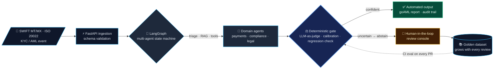

<!-- ═══════════════════════════════════════════════════════════════════════
     Manoj Kumar P · GitHub profile README
     Paste this whole file into github.com/manojrevenkar12-web/manojrevenkar12-web/README.md
     ═══════════════════════════════════════════════════════════════════════ -->

 

&nbsp;
&nbsp;
&nbsp;

  

 

## 🧭 About me

<table>
<tr>
<td width="50%" valign="top">

### What I build
- **Agentic systems that are governed, not just clever** — LangGraph state machines with human-in-the-loop escalation, hash-chained audit trails and deterministic release gates.
- **Evaluation as infrastructure** — LLM-as-judge pipelines, measured noise floors, regression detection wired into CI so a model can't ship if it got worse.
- **Models that know when to abstain** — calibrated confidence, abstention and active-learning loops for vision and language models.
- **RAG and retrieval over regulated, messy data** — payment messages, compliance alerts, legal and tax documents.

</td>
<td width="50%" valign="top">

### Where I come from
- **14+ years inside global banks** — Wells Fargo, JPMorgan Chase, Standard Chartered, ANZ and National Bank of Canada (via CGI).
- **Payments is my home turf** — SWIFT MT/MX, ISO 20022, SEPA, KYC/AML, Oracle FLEXCUBE / OBPM. I know what a `pacs.008` has to look like before an agent touches it.
- **Led an 8-engineer GenAI & automation team** at Wells Fargo — roadmap, hiring, stakeholder scope, shipped RAG-based log analysis and LLM test-data generation for MT103 / MT202 / pacs.008.
- **Now in Berlin**, building in the open and available immediately.

</td>
</tr>
</table>

 

## 🚀 Featured projects

<table>
<tr>
<td width="50%" valign="top">

### 🕵️ [aml-investigator](https://github.com/manojrevenkar12-web/aml-investigator)
**Autonomous KYC / AML compliance investigator**

A multi-agent LangGraph state machine that triages financial-crime alerts, gathers evidence, drafts regulator-ready **goAML** reports (XSD-validated) and escalates anything uncertain to a human reviewer — every step recorded in a **hash-chained audit trail**. Full-stack: FastAPI backend, React/TypeScript review console.

    

🔗 [Repo](https://github.com/manojrevenkar12-web/aml-investigator) · 🌐 [Live demo](https://aml-investigator.onrender.com) (free tier, ~50 s cold start)

</td>
<td width="50%" valign="top">

### 🏦 [swift-ai-engine](https://github.com/manojrevenkar12-web/swift-ai-engine)
**SWIFT & ISO 20022 Intelligence Engine**

AI-powered payment-message analysis: explains any MT/MX message in plain English, flags anomalies, performs **MT → MX (ISO 20022) migration**, and generates test cases from real message structures. Built by someone who has read thousands of these messages by hand.

    

🔗 [Repo](https://github.com/manojrevenkar12-web/swift-ai-engine) · 🌐 [Live demo](https://swift-ai-engine.streamlit.app)

</td>
</tr>
<tr>
<td width="50%" valign="top">

### 📉 [model-regression-detector](https://github.com/manojrevenkar12-web/model-regression-detector)
**CI-gated LLM evaluation pipeline — the release gatekeeper**

Async evaluation engine that scores a model against a golden dataset with **LLM-as-judge**, measures the **noise floor** and sets warning / critical thresholds empirically — so the merge gate fires on real regressions, not randomness. HTML diff reports, Slack alerts, SQLite history, GitHub Actions gate, Dockerised, 64 passing tests.

    

🔗 [Repo](https://github.com/manojrevenkar12-web/model-regression-detector)

</td>
<td width="50%" valign="top">

### 🔍 [item-identifier](https://github.com/manojrevenkar12-web/item-identifier)
**Fine-grained visual identification that knows when it's unsure**

Production computer-vision pipeline on **DINOv2** features with **calibrated confidence and abstention**, an active-learning loop for the hard cases, FastAPI + **ONNX Runtime** serving, and CI release gates on accuracy. **90.6 % top-1 on Stanford Cars.**

    

🔗 [Repo](https://github.com/manojrevenkar12-web/item-identifier)

</td>
</tr>
<tr>
<td width="50%" valign="top">

### 🤐 [llm-abstention-tuning](https://github.com/manojrevenkar12-web/llm-abstention-tuning)
**Post-training an LLM to say "I don't know"**

Hallucination-reduction experiments: post-training recipes that teach an open model to abstain when it lacks grounding instead of inventing an answer, with a full train → evaluate loop that reports the trade-off between coverage and correctness.

   

🔗 [Repo](https://github.com/manojrevenkar12-web/llm-abstention-tuning)

</td>
<td width="50%" valign="top">

### 🎯 [reward-uplift-lab](https://github.com/manojrevenkar12-web/reward-uplift-lab)
**Causal uplift & policy-optimisation workbench**

Experimentation lab for estimating treatment uplift, modelling rewards and evaluating policies — the statistics behind "did this change actually help, and for whom?", applied to both predictive and generative pipelines.

   

🔗 [Repo](https://github.com/manojrevenkar12-web/reward-uplift-lab)

</td>
</tr>
</table>

 

## 🧠 How I think about production AI

The same pattern runs through most of my repos: **an agent is allowed to act only after a deterministic gate says it may.**

 

## 🗂️ More projects

<b>🏦 Payments, banking & compliance AI</b>

 

| Project | What it is | Stack |
|---|---|---|
| [identity-risk-graph](https://github.com/manojrevenkar12-web/identity-risk-graph) | Identity risk graph — scoring fraud and KYC risk across linked identities and accounts | `graph` `risk scoring` `Python` |
| [tm-model-lifecycle](https://github.com/manojrevenkar12-web/tm-model-lifecycle) | Transaction-monitoring (AML) model lifecycle — development, validation, monitoring | `Python` `scikit-learn` `model risk` |
| [controllable-finance-agents](https://github.com/manojrevenkar12-web/controllable-finance-agents) | AI agents for finance operations with explicit control points and audit | `LangGraph` `FastAPI` |
| [payments-lakehouse-accelerator](https://github.com/manojrevenkar12-web/payments-lakehouse-accelerator) | Spark / Delta Lake accelerator for payments data on Databricks | `PySpark` `Delta` `Databricks` |
| [payment-ops-copilot](https://github.com/manojrevenkar12-web/payment-ops-copilot) | RAG copilot for payment operations on the MEAN stack | `LangChain` `ChromaDB` `Node` `Angular` |
| [governed-ai-gateway](https://github.com/manojrevenkar12-web/governed-ai-gateway) | Governed LLM gateway for regulated enterprises — policy, routing, audit | `FastAPI` `policy` |
| [payment-qa-dashboard](https://github.com/manojrevenkar12-web/payment-qa-dashboard) | Real-time payment telemetry & release observability dashboard | `JavaScript` `Playwright` |

<b>🧪 LLM evaluation, reliability & research</b>

 

| Project | What it is | Stack |
|---|---|---|
| [agentic-engineering-harness](https://github.com/manojrevenkar12-web/agentic-engineering-harness) | Benchmark harness for coding agents — tasks, scoring, cost/latency tracking | `Python` `agent eval` |
| [cx-agent-context-lab](https://github.com/manojrevenkar12-web/cx-agent-context-lab) | Context-engineering & prompt-caching lab for contact-centre agents | `prompt caching` `eval` |
| [probabilistic-synthetics](https://github.com/manojrevenkar12-web/probabilistic-synthetics) | Synthetic monitoring & alerting for non-deterministic AI systems | `TypeScript` `monitoring` |
| [defense-rl-gym](https://github.com/manojrevenkar12-web/defense-rl-gym) | Reinforcement-learning environments for defensive security | `RL` `Gymnasium` |
| [chat-exposure-guard](https://github.com/manojrevenkar12-web/chat-exposure-guard) | Application-security guard against data exposure in chat / LLM apps | `AppSec` `Python` |

<b>⚙️ Agent platforms & AI infrastructure</b>

 

| Project | What it is | Stack |
|---|---|---|
| [model-router-platform](https://github.com/manojrevenkar12-web/model-router-platform) | LLM gateway — model routing, rate limits, usage billing | `FastAPI` `Postgres` `Redis` |
| [power-desk-agent-platform](https://github.com/manojrevenkar12-web/power-desk-agent-platform) | Governed agent platform on AWS Bedrock / AgentCore for a power-trading desk | `Bedrock` `AgentCore` |
| [rechtsschutz-agent](https://github.com/manojrevenkar12-web/rechtsschutz-agent) | LangGraph intake agent for legal-protection insurance claims | `LangGraph` `German legal` |
| [legal-invoice-review-agents](https://github.com/manojrevenkar12-web/legal-invoice-review-agents) | Multi-agent review of law-firm invoices against billing guidelines | `agents` `document AI` |
| [tax-notice-desk](https://github.com/manojrevenkar12-web/tax-notice-desk) | Document intelligence + RAG over tax law for German tax notices | `RAG` `evals` |
| [symbolic-trace-compiler](https://github.com/manojrevenkar12-web/symbolic-trace-compiler) | PyTorch trace compiler with symbolic shapes | `PyTorch` `compilers` |

<b>👁️ Vision, speech, robotics & signals</b>

 

| Project | What it is | Stack |
|---|---|---|
| [care-stt](https://github.com/manojrevenkar12-web/care-stt) | German speech-to-text for care documentation | `Whisper` `speech ML` |
| [station-cycle-vision](https://github.com/manojrevenkar12-web/station-cycle-vision) | Assembly-station video → cycle-time analytics | `computer vision` `PyTorch` |
| [pod-pick-lab](https://github.com/manojrevenkar12-web/pod-pick-lab) | Robotic fabric-pod picking lab | `robotics` `perception` |
| [spectrum-ssl-edge](https://github.com/manojrevenkar12-web/spectrum-ssl-edge) | Self-supervised learning on RF spectrum data, edge-deployable | `signal ML` `SSL` |
| [bodensee-sar-autonomy](https://github.com/manojrevenkar12-web/bodensee-sar-autonomy) | Deep-RL planning for UAV search-and-rescue over Lake Constance | `RL` `simulation` |
| [uxv-ml-platform](https://github.com/manojrevenkar12-web/uxv-ml-platform) | ML platform for drone / UxV sensor data | `ML platform` `MLOps` |

 

## 🛠️ Tech stack

**Generative & Agentic AI**

        

**ML & Data**

 
    

**Backend, platform & delivery**

**Payments & regulatory domain**

     

 

## 📊 GitHub activity

  

  

 

## 📜 Certifications

 &nbsp;

 

## 🤝 Let's build something

I'm based in **Berlin** and open to **Senior AI / Generative AI / Agentic AI Engineer** roles anywhere in Germany — especially where AI has to meet regulation, money or both.

 

&nbsp;

  

⭐ If one of these repos helps you, a star goes a long way.

